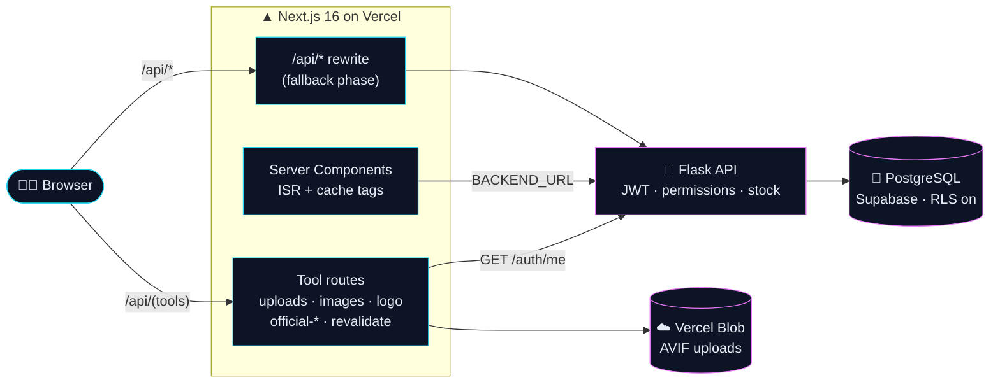

<div align="center">

<a href="https://revotech-m3.vercel.app/">
  
</a>

### The storefront for the RevoTech computer-parts shop. Its API is the Flask backend built in Module 2.

Live search · cart and checkout · an admin dashboard · a build planner that checks your parts actually fit together

<br/>

[](https://revotech-m3.vercel.app/)
[](https://revotech-m2.vercel.app/health)
[](https://revotech-m2.vercel.app/apidocs)
[](#-run-the-tests)
[](https://github.com/jim1504/Revou-revoshop-jim1504)

[](https://nextjs.org)
[](https://react.dev)
[](https://www.typescriptlang.org)
[](https://tailwindcss.com)
[](https://nodejs.org)
[](https://playwright.dev)
<br/>
[](https://www.python.org)
[](https://flask.palletsprojects.com)
[](https://www.sqlalchemy.org)
[](https://supabase.com)
[](https://flask-jwt-extended.readthedocs.io)
[](https://vercel.com)

<br/>

<table>
  <tr>
    <td align="center" width="120"><h2>23</h2><sub>PARTS IN STOCK</sub></td>
    <td align="center" width="120"><h2>6</h2><sub>CATEGORIES</sub></td>
    <td align="center" width="120"><h2>3</h2><sub>ROLES</sub></td>
    <td align="center" width="120"><h2>331</h2><sub>E2E RUNS</sub></td>
    <td align="center" width="120"><h2>4</h2><sub>BROWSERS</sub></td>
    <td align="center" width="120"><h2>4K</h2><sub>READY</sub></td>
  </tr>
</table>

**[Overview](#-overview)** · **[Links](#-links)** · **[Features](#-features)** · **[Stack](#-tech-stack)** · **[Architecture](#-how-the-data-works)** · **[Quick start](#-run-it-locally)** · **[Tests](#-run-the-tests)** · **[Deploy](#-deploy-to-vercel)** · **[Rubric](#-checkpoint-1--fundamentals)** · **[Roles](#-roles-and-permissions)**

</div>

<br/>


---

## 🛸 Overview

RevoTech sells **23 current-generation parts in six categories**: Intel Core Ultra Plus and Ryzen 9000 X3D
processors, LGA1851 and AM5 motherboards, DDR5 memory and PCIe 5.0 storage, RTX 50 and RDNA 4 graphics, power and
cooling, and peripherals.

### 🔗 Links

<table>
<tr>
<th width="50%" align="left">🛍️ STOREFRONT · Next.js 16 (this repo)</th>
<th width="50%" align="left">🐍 API · Flask 3.1 (Module 2)</th>
</tr>
<tr>
<td valign="top">

🌐 **Live store:** [revotech-m3.vercel.app](https://revotech-m3.vercel.app/)

🧩 [Products](https://revotech-m3.vercel.app/products) · [Build planner](https://revotech-m3.vercel.app/build) · [Login](https://revotech-m3.vercel.app/login)

🗺️ [sitemap.xml](https://revotech-m3.vercel.app/sitemap.xml) · [robots.txt](https://revotech-m3.vercel.app/robots.txt)

💻 **Source:** [jim1504/Revou-module_3-RevoTech](https://github.com/jim1504/Revou-module_3-RevoTech)

🧪 **Playwright:** 83 tests × 4 browsers, run locally ([how](#-run-the-tests))

🎮 **Demo accounts:** [in Quick start](#-run-it-locally)

👤 **Portfolio:** [jimwilliam.vercel.app](https://jimwilliam.vercel.app/), also at the short link [/portfolio](https://revotech-m3.vercel.app/portfolio)

</td>
<td valign="top">

🌐 **Base URL:** `https://revotech-m2.vercel.app`

💓 **Health check:** [/health](https://revotech-m2.vercel.app/health) (runs a real database query)

📘 **Swagger UI:** [/apidocs](https://revotech-m2.vercel.app/apidocs) (try every endpoint in the browser)

📦 **Sample data:** [/products](https://revotech-m2.vercel.app/products) · [/categories](https://revotech-m2.vercel.app/categories)

💻 **Source:** [jim1504/Revou-revoshop-jim1504](https://github.com/jim1504/Revou-revoshop-jim1504)

🧪 **pytest:** 83 tests · **Postman:** collections in `postman/` · **Locust:** `locustfile.py`

</td>
</tr>
</table>

> [!TIP]
> If `/health` answers `{"status":"ok","database":"connected"}`, both the API and its Supabase database are up. The
> **API & DATABASE** badge at the top reads that same field live.

| | Who | What they get |
|:---:|---|---|
| 🛒 | **Shoppers** | Browse, search by model number, filter by category, and plan a whole build |
| 👤 | **Customers** (signed in) | A cart that survives refreshes, checkout, and order tracking |
| 🛠️ | **Admins** | Product and category management, plus revenue, stock and order status at a glance |

The design direction is **neon cyber-grid**: a deep navy base, cyan and magenta accents, a drifting grid, glowing
borders and monospace numerals.

## ⚡ Features

| | Area | What's there |
|:---:|---|---|
| 🧭 | **Catalogue** | Home with a hero slider and featured parts · `/products` with live search, `?search=` and `?category_id=` URLs · product detail with an image gallery (hover zooms 2.5× into the full-resolution photo), key features, a stock meter, a link to the manufacturer's page, a credited overview, the full spec table and related parts · `/categories` |
| 🛒 | **Cart & checkout** | Add with a quantity; a cart table with per-row quantity and remove; totals; checkout disabled when the cart is empty; `POST /orders`; order history and detail |
| 🔑 | **Accounts** | Register (4 validation rules), log in, session restored on refresh, redirects by role, and an account page for your own profile and password |
| 🛡️ | **Roles** | Three: superadmin, admin and customer. Checked in the UI *and* on every write endpoint ([details](#-roles-and-permissions)) |
| 🛠️ | **Admin** | Product CRUD in modals (official link; overview; spec tables fetched from the official page or pasted from the browser; up to 12 images, every upload converted to AVIF) · category CRUD with a deletion guard · order handling (status pipeline, cancel/reopen with restock, shipping address) · stats HUD · **edit in place** from an admin bar on the homepage, the About page and every product page |
| 🌗 | **Admin area** | Full width, with the dashboard tabs in a **vertical sidebar** (a scrolling row on phones), no storefront footer, and a **dark/light theme** switch for staff |
| 🖥️ | **Screens** | From 390 px phones up to **4K monitors**: above 1920 px the whole layout scales with the window, so on a 4K screen it fills the width instead of sitting in a narrow strip |
| ✨ | **Extras** | A card-to-detail **view transition**, a **Ctrl/⌘ K command palette**, and a **build planner** with compatibility checks |
| 🐍 | **Backend** | The Module 2 **Flask API** on PostgreSQL (Supabase): JWT sign-in, permission checks on every write, stock that moves with orders, page content, settings and the logo. Proxied through `/api`, so the browser never calls another origin |
| 🧪 | **Quality** | 83 Playwright tests × 4 browsers, end to end against a real Flask API (plus 83 `pytest` tests in the backend), toasts for every write, and skeleton loaders and error boundaries on every data route |

## 🧬 Tech stack

<table>
<tr><th align="left">Frontend</th><th align="left">Version</th><th align="left">Backend (Module 2 repo)</th><th align="left">Version</th></tr>
<tr><td>Next.js (App Router, Turbopack)</td><td><code>16.4</code></td><td>Python</td><td><code>3.14</code></td></tr>
<tr><td>React</td><td><code>19.3</code></td><td>Flask / Flask-SQLAlchemy</td><td><code>3.1</code> / <code>3.1</code></td></tr>
<tr><td>TypeScript (strict)</td><td><code>6.0</code></td><td>SQLAlchemy</td><td><code>2.1</code></td></tr>
<tr><td>Tailwind CSS (CSS-first <code>@theme</code>)</td><td><code>4</code></td><td>Flask-JWT-Extended</td><td><code>4.7</code></td></tr>
<tr><td>react-hot-toast</td><td><code>2.6</code></td><td>psycopg</td><td><code>3.3</code></td></tr>
<tr><td>Playwright</td><td><code>1.64</code></td><td>PostgreSQL</td><td>Supabase</td></tr>
<tr><td>sharp (image pipeline, upload conversion)</td><td><code>0.35</code></td><td>Alembic (via Flask-Migrate)</td><td><code>1.20</code></td></tr>
<tr><td>@vercel/blob (uploads in production)</td><td><code>2.8</code></td><td>pytest</td><td><code>9.1</code></td></tr>
</table>

> [!NOTE]
> **Node.js 24.x** (`engines` in `package.json`, pinned to one major so Vercel never jumps to a new Node major on its own). It is Vercel's default and newest runtime, and `@types/node` matches it. Newer Node versions work locally too.

<details>
<summary><b>🧊 Version notes: what's held back, and why</b></summary>
<br/>

- **TypeScript 7** (the native compiler) is held back. Next.js 16.4 can type-check with it, but typescript-eslint
  won't load with TypeScript 7, because it needs the JavaScript compiler API that 7.0 doesn't ship. 6.0 is the
  newest version it supports (`<6.1.0`).
- **ESLint 10** is in use; `eslint-config-next` supports it from 16.4.0 (per the Next.js 16 upgrade guide, and
  checked here: every rule family still fires). `npm install` prints `ERESOLVE overriding peer dependency` warnings,
  because three plugins bundled in `eslint-config-next` (react, jsx-a11y, import) haven't widened their declared
  ESLint range yet. The warnings are about version metadata only. Next 16 doesn't lint during `next build`, so they
  can't affect a deploy either.
- **`allowScripts`** in `package.json` is the list npm 12 uses to decide which dependencies may run install scripts.
  `unrs-resolver` is denied, because its script only downloads a native binary that npm already installs.

</details>

## 🛰️ How the data works

The backend is the **Module 2 Flask API** ([jim1504/Revou-revoshop-jim1504](https://github.com/jim1504/Revou-revoshop-jim1504),
deployed at `https://revotech-m2.vercel.app`, on PostgreSQL in Supabase). This app has no database
of its own. Products, categories, users, orders, page content, store settings and the logo all live in the API.



- **The browser never calls another origin.** It sends every request to `/api/...` on this site
  (`NEXT_PUBLIC_API_BASE_URL`), and `next.config.ts` proxies it to `BACKEND_URL`. So the API needs no CORS, and the
  browser only ever sees this site's address. The rewrite runs in the `fallback` phase, after every page and route
  handler, so this app's own `/api` routes answer first.
- **Server Components call the API directly** at `BACKEND_URL` (`lib/api.server.ts`), for public data only:
  products, categories, page content and settings, with per-page caching (see
  [Rendering strategies](#rendering-strategies)).
- **Private data loads in the browser.** Orders and profiles need the signed-in user's token, and only the browser
  has it. So those pages fetch client-side (`hooks/useApiData.ts`) with `Authorization: Bearer <token>`.
- **After an admin's write**, the browser asks `POST /api/revalidate` to expire the cached pages that show that
  data, by tag: `catalog`, `content-home`, `content-about` or `settings`. The route first checks the caller's token
  and permission with the API.

> [!CAUTION]
> `NEXT_PUBLIC_API_BASE_URL` is an HTTP address, never a database URL. Anything prefixed `NEXT_PUBLIC_` is compiled
> into the JavaScript the browser downloads, so a connection string there would publish the database password. The
> database URL belongs to the Flask app alone.

**What this app still does itself** (tools, not data):

| Route | Does |
|---|---|
| `POST /api/uploads`, `GET /api/images/<file>` | Converts any uploaded image to AVIF in three sizes (Vercel Blob in production, `.data/uploads` locally) |
| `POST /api/uploads/release` | Deletes uploads that a product just stopped using |
| `GET /api/official-preview`, `GET/POST /api/official-specs` | Reads a manufacturer's page for the product form: its summary and spec table |
| `GET /api/logo`, `POST /api/logo/vectorize` | Serves the logo as SVG from the vector paths the API stores, and traces an uploaded image into those paths |
| `POST /api/revalidate` | Refreshes cached pages after a write |
| `/robots.txt`, `/sitemap.xml` | Built from the API's product list |

These routes check the caller the same way the API does. They pass the token to the API's `GET /auth/me`, and the
permission comes from the same table (`lib/roles.ts` here, `models.PERMISSIONS` in the API).

**One source for the catalogue.** `data/catalog.json` holds the Module 2 seed data **refreshed to current-generation
parts** (i5-14400F → Core Ultra 5 250K Plus, RTX 4070 Super → MSI RTX 5070 Gaming Trio OC, Kingston DDR4 → Corsair
Dominator Titanium DDR5-7600, 980 Pro → 9100 Pro). It also feeds the product photos
(`lib/generated/product-meta.json`). `npm run seed:export` writes it, with the default page content and settings,
to the backend repo's `seed_data.json`, and the API's `seed_db.py` loads that file. So product names, photos and
specs always match.

## 🚀 Run it locally

**1 · Start the API** in the backend repo (Module 2):

```bash
flask db upgrade           # creates/updates the tables in its DATABASE_URL
python seed_db.py          # loads seed_data.json (destructive: empties the tables first)
waitress-serve --port=5000 app:app
```

**2 · Start the storefront** here:

```bash
npm install
cp .env.example .env.local      # BACKEND_URL=http://localhost:5000 is the default
npm run dev                     # → http://localhost:8100
```

`npm run dev` first copies the AVIF images from `assets/` into `public/` (`predev`).

> [!WARNING]
> To develop against the deployed API instead, set `BACKEND_URL=https://revotech-m2.vercel.app` in
> `.env.local`. That's real production data, so be careful with writes.

**🎮 Demo accounts.** All three use the password `password123`, and the login page has a one-click button for each:

| Role | Email | Gets |
|---|---|---|
| 👑 Superadmin | `andi.pratama@example.com` | Everything, including Users and Settings |
| 🛠️ Admin | `budi.santoso@example.com` | Products, categories, orders and page content |
| 🛒 Customer | `siti.rahayu@example.com` | The shop, and their own account page |

**Seeing the loading and error states.** Throttle the network in your browser's DevTools to see the `loading.tsx`
skeletons, and stop the Flask server to see the `error.tsx` boundaries.

<details>
<summary><b>📜 All npm scripts</b></summary>
<br/>

| Command | Does |
|---|---|
| `npm run dev` / `build` / `start` | Next.js |
| `npm run lint` / `typecheck` | ESLint (flat config) / `tsc --noEmit` |
| `npx playwright test` | The end-to-end suite (starts its own Flask API, see below) |
| `npm run seed:export` | Writes the catalogue, page content and settings to the backend's `seed_data.json` |
| `npm run catalog:check` | Validates `data/catalog.json` (ids, prices, order totals) |
| `npm run images:all` | Rebuilds every image: fetch, generate, banners, variants |
| `npm run brand:logo` | Rebuilds the default logo (`data/logo.json`) from `assets/brand/logo-source.jpg`, with the same SVG converter as the settings page |
| `npm run images:gallery` | Builds the multi-image galleries from the folders listed in `scripts/gallery-sources.json` |
| `npm run catalog:specs` | Fills in missing spec tables from each product's spec page or official page (`-- --force` refetches all) |
| `npm run catalog:overviews` | Fills in missing overviews from each product's official page (`-- --force` refetches all) |
| `node scripts/screenshots.mjs --base=<url>` | Re-captures `docs/screenshots/` |

</details>

## 🧪 Run the tests

```bash
npx playwright install              # once
npx playwright test                 # all four browsers; --project=chromium for just one
npx playwright show-report          # HTML report
```

```text
  ✓ chromium   ✓ firefox   ✓ webkit   ✓ edge          331 passed · 1 skipped (Firefox synthetic paste)
```

Locally the suite runs against **its own Flask API and database**, so it never touches your development data.
`scripts/e2e-backend.mjs` sets it up:

- creates the local `revoshop_e2e` database if it doesn't exist (`E2E_DATABASE_URL` changes it);
- migrates and reseeds it before every run;
- serves the backend repo on port 5055 (`BACKEND_DIR`, `E2E_BACKEND_PORT`).

Playwright then starts `npm run dev`, pointed at that API. The script wipes the database it uses, so it refuses any
database that isn't on localhost.

To run against the live deployment (no reseeding; specs that would write to the production database are skipped or
mocked):

```bash
PLAYWRIGHT_BASE_URL=https://revotech-m3.vercel.app npx playwright test
```

The API's own rules are unit-tested in the backend repo (`pytest`, 83 tests): every permission, stock moving with
orders, the profile and role rules, and content, settings and logo validation. This suite tests the storefront end to
end on top of them.

<details>
<summary><b>🔍 What each spec covers (15 specs + global setup)</b></summary>
<br/>

| Spec | Covers |
|---|---|
| `home.spec.ts` | Heading visible; clicking Products → URL is `/products` (first with role locators, then refactored to `getByTestId`); hero slider controls, autoplay and pause |
| `register.spec.ts` | Each of the four validation rules, and that an invalid form never sends a request |
| `auth.spec.ts` | Register → signed in → survives a refresh → log out → log back in; a bad password; an admin lands on `/dashboard`; "Login to buy" returns to the product; route guards |
| `mock.spec.ts` | `page.route()` mocks `GET /products`: custom data, a 500, an empty result |
| `browse.spec.ts` | Search → detail → add 2 → cart survives a refresh → checkout → the order appears; category filter; empty cart; signing out empties and hides the cart |
| `build.spec.ts` | A socket clash is flagged on the slots and marked in the dropdown before you pick; a DDR5-7600 kit on the H810 board (falls back to 4800 MT/s) and on AM5 (Intel XMP only), no warning on B860; the status bar on narrow screens |
| `settings.spec.ts` | Settings validation; the logo served as locked-down SVG in full and square variants; an uploaded PNG traced to SVG paths in its real colours; nothing from an uploaded SVG (scripts, handlers) reaches the output; non-images rejected; renaming the shop and switching to WITA / 12-hour updates the title, header and order dates; a new logo changes the favicon |
| `promo.spec.ts` | The new-arrivals pop-up shows once, on the first page a visitor opens; it leads with the iCUE LINK TITAN II and stays away after being clicked through, closed with Esc, or on sign-in |
| `dashboard.spec.ts` | Create → success toast and new row → edit the price → delete with confirmation; validation; the 409 delete guard; a product that is only in past orders is withdrawn from sale instead of deleted |
| `media.spec.ts` | Hover zoom follows the pointer and uses the full-resolution image; uploads a product drops are deleted (a shared one only when the last product lets go of it, seeded photos never); official link and credited overview; the summary fetcher refuses private addresses; images hosted elsewhere are rejected; uploads come back as AVIF; upload → reorder → save → gallery on the product page (the upload specs run locally only) |
| `rbac.spec.ts` | Through the rewrite and this app's own routes: 401 without a token, and 403 naming the permission for a customer on every admin-only endpoint (the API's and this app's); an admin may edit the catalogue but not settings or users; orders are private; a customer edits only their own profile, can't grant themselves a role, and needs their current password to change it; a superadmin resets a password without it and can't change their own role; each role's dashboard tabs; the account page end to end |
| `admin.spec.ts` | Customers see Orders and no admin bars, admins see Dashboard instead; editing a product from its page, the homepage (slide, heading, featured pick, validation) and the About page, each surviving a fresh load; content validated by the API; the `PUT /orders` contract; mark paid → cancel (restocks) → reopen → change the address |
| `specs.spec.ts` | The grouped spec table with its source and "Show all" (NVIDIA's RTX 5060 column, not the Ti's); pasted HTML → rows; the spec fetcher refuses private addresses; invalid rows are rejected; paste → edit → save → product page; "Label: value" text |
| `layout.spec.ts` | The root font size at 1440, 1920, 2560 and 3840 px, and the page column growing with it; the dashboard at full width with stacked sidebar tabs and no footer (the storefront keeps its footer); tabs in a row on a phone with no sideways scroll; the light theme switching, surviving a reload from the first paint, staying off the storefront, and never applying to a customer |
| `seo.spec.ts` | `robots.txt` lets crawlers into the shop but not the dashboard, account, checkout or API, and names the sitemap; `sitemap.xml` lists the storefront pages and every product for sale with its image, and leaves out the one that isn't; `/portfolio` is a temporary (307) redirect to the portfolio site, which the About page's button (new tab) and the footer link to |
| `global-setup.ts` | Reseeds the e2e database (locally), registers a test customer through `POST /users` (no UI), and signs it and the two seeded staff accounts in through `POST /auth/login`. Each session `{ id, username, email, role, token }` is saved to `tests/.auth/`, and the tokens are kept for the specs' direct API calls |

</details>

## ☁️ Deploy to Vercel

There are two Vercel projects, the **Flask API** (backend repo, already deployed) and **this app**. Uploaded images go
to **Vercel Blob**.

**1 · The API and its database.** In the backend repo, follow the *Deployment* section of its README. In short, from
your machine with `DATABASE_URL` set to the Supabase **session pooler** URL:

1. back up with `pg_dump`;
2. run `flask db upgrade` (adds the storefront's tables and columns, renames the roles, and turns on row level
   security);
3. run `python seed_db.py` (destructive: loads the refreshed 23-part catalogue);
4. push the backend so Vercel redeploys it.

**2 · Images: Vercel Blob.** In this app's Vercel project, go to **Storage → Create → Blob → Connect to project**.
That adds `BLOB_READ_WRITE_TOKEN` to the project's environment variables, and there's nothing else to configure.
Uploads then go to the Blob CDN. Only the three converted AVIFs are kept, never the original, and unused ones are
deleted (see *Uploads and storage clean-up* under [Deep dives](#-deep-dives)).

**3 · This app.**

1. Push the repository to GitHub.
2. **Add New → Project →** import the repository. The framework is detected automatically; the root directory is
   `./`.
3. Under **Settings → Environment Variables** (Production, and Preview if you want previews on the same data):

   | Variable | Value |
   |---|---|
   | `BACKEND_URL` | `https://revotech-m2.vercel.app` |
   | `BLOB_READ_WRITE_TOKEN` | added in step 2 |
   | `API_SECRET_KEY` | any long random string |

   `NEXT_PUBLIC_API_BASE_URL` isn't needed: it defaults to `/api` in code (`lib/api.ts`), which `next.config.ts`
   proxies to `BACKEND_URL`.
4. **Deploy**, or **Redeploy** after changing variables. The build reads the variables too, because the catalogue
   pages are prerendered from the API, so the API must be up during the build.
5. Run the test suite against the live URL ([above](#-run-the-tests)).
6. **Analytics → Enable** in the Vercel project. The `<Analytics />` component in `app/layout.tsx` (Vercel Web
   Analytics) then reports page views, including client-side navigations, to the project's Analytics tab. It sends
   nothing in development or outside Vercel, and it uses no cookies.

**Environment files.** There are two, and only one of them is committed:

| File | Committed | Holds |
|---|:---:|---|
| `.env.example` | ✅ | Every variable the project understands, documented, with placeholder values. Copy it to `.env.local`. It also carries the Module 2 backend block (PostgreSQL, Flask, Gunicorn). This app doesn't read that block, but the same values go in DBeaver and in the Flask project's own `.env`. |
| `.env.local` | ❌ | Your real values. Locally the defaults work: `BACKEND_URL=http://localhost:5000`, `NEXT_PUBLIC_API_BASE_URL=/api`, `API_SECRET_KEY=…`. Add `BLOB_READ_WRITE_TOKEN` to upload to Blob. |

Everything else has a default in code: the API address (`http://localhost:5000`), the browser's API base (`/api`),
the port (8100, passed by the npm scripts), and the Playwright base URL (`http://localhost:8100`; override it with
`PLAYWRIGHT_BASE_URL`).

---

## 🎓 Checkpoint 1 — Fundamentals

Checkpoint 1 lives on the **About me** page, [`/about`](app/about/page.tsx). Its *View my full portfolio* button opens
[jimwilliam.vercel.app](https://jimwilliam.vercel.app/), the author's portfolio site; `/portfolio` is a short link
to it (a temporary redirect in `next.config.ts`), and `/about` itself stays here. There's also a plain, framework-free
version of the same profile at [`/checkpoint-1/index.html`](public/checkpoint-1/index.html), with the same brand and
no build step. The JW logo there is a static `logo.svg`, written by the same converter as the app's
(`npm run brand:logo`).

<details>
<summary><b>📋 Rubric map: 14 items</b></summary>
<br/>

| Rubric item | Where |
|---|---|
| Semantic HTML5 profile page | `public/checkpoint-1/index.html`: `header`, `nav`, `main`, `section`, `article`, `aside`, `footer` |
| Contact form with input types and labels | Same file (`email`, `tel`, `select`, `textarea`, `<label for>`), and `components/about/ContactForm.tsx` |
| CSS selectors and the box model | `public/checkpoint-1/styles.css`: `box-sizing`, explicit margin / border / padding on `.section` |
| CSS Grid layout | `.skill-grid`, `.project-list`, `.contact-form` in `styles.css`; the skills grid on `/about` |
| Responsive breakpoints | `@media (max-width: 900px)` and `(max-width: 640px)` in `styles.css`; mobile-first Tailwind on `/about` |
| Variables, types, operators, functions | `components/about/DomLab.tsx` |
| Select / update DOM, toggle classes, create / remove elements | `DomLab.tsx`: `querySelector`, `createElement`, `classList.toggle`, `remove()`, `replaceChildren()` |
| `click` / `submit` handlers, `preventDefault` | `DomLab.tsx` (`addEventListener`), `ContactForm.tsx` |
| `forEach`, `map`, `filter`, `reduce` | `components/about/ArrayLab.tsx`: each shown next to its live result over the real catalogue |
| TypeScript interfaces, type aliases, union types | `lib/types.ts`: `Product`, `OrderStatus`, `Availability`; `lib/roles.ts`: `Role`, `Permission` |
| Nested objects and arrays typed | `OrderDetail` with `OrderItem[]`, `CategoryDetail` with `Product[]` |
| Tailwind installed, utility-first | `app/globals.css` (Tailwind v4 `@theme`), used throughout |
| Typed data mapped to Tailwind classes | `getButtonClasses(inStock: boolean)` in `lib/classes.ts`; availability → badge tone in `components/ui/Badge.tsx` |
| Typed interactive catalogue: renders, live search, state update | `/products`: `ProductList.tsx` filters as you type, and adding to the cart updates the header count |

</details>

| Desktop | Mobile |
|---|---|
|  |  |
|  |  |

## 🎓 Checkpoint 2 — Components & App Router

<details>
<summary><b>⚛️ React components: rubric map</b></summary>
<br/>

| Rubric item | Where |
|---|---|
| `Header`, `Footer`, `ProductCard` as typed function components | `components/layout/Header.tsx`, `Footer.tsx`, `components/product/ProductCard.tsx` |
| `ProductCardProps` with optional props and destructuring defaults | `ProductCard.tsx`: `showDescription = true`, `showStock = true`, `readOnly = false` … |
| `Card` wrapper | `components/ui/Card.tsx` |
| Quantity counter on `ProductCard` | `components/ui/QuantityCounter.tsx`, used in the card |
| Conditional rendering | `ProductCard.tsx`: unavailable overlay, low-stock warning, "In cart ×n", "Login to buy" vs "Add to cart" |
| `getButtonClasses(inStock: boolean): string` | `lib/classes.ts` |
| One `.map()` over `Product[]`, no hardcoded cards | `components/product/ProductGrid.tsx` |
| `SearchBar` with `onChange` | `components/product/SearchBar.tsx` (controlled; also `onSubmit` on Enter) |
| Immutable add-to-cart | `context/CartContext.tsx`: spread and `.map()`, never mutation |
| `AddProductForm`, controlled inputs, `validate(data: FormState): FormErrors` | `components/dashboard/AddProductForm.tsx` |
| New products appended with the spread pattern | `ProductManager.tsx`: `setProducts(prev => [...prev, p])` |
| Cart summary with count and total | `components/product/CartSummary.tsx` on `/products`, and the header pill |

</details>

<details>
<summary><b>🧭 App Router and data fetching: rubric map</b></summary>
<br/>

| Rubric item | Where |
|---|---|
| Routes as `page.tsx` under `app/` | `/`, `/products`, `/products/[id]`, `/categories`, `/orders`, `/orders/[id]`, `/about`, `/build`, `/cart`, `/checkout`, `/login`, `/register`, `/dashboard/*` |
| Root layout with `<Header />` / `<Footer />`, nested `app/products/layout.tsx` | `app/layout.tsx`, `app/products/layout.tsx` |
| Nested layout stays mounted | The **catalogue session timer** under the header keeps counting between `/products` and `/products/[id]`; the console logs `[products/layout] mounted` once |
| Active route styling with `usePathname()` | `Header.tsx` |
| `router.push('/products?search=…')` on Enter, `useSearchParams()` on the page | `Header.tsx` (`HeaderSearch`), `ProductList.tsx` |
| `NEXT_PUBLIC_API_BASE_URL` and `API_SECRET_KEY` | `.env.local`; the secret is sent server-side only, as `x-api-key` (`lib/api.server.ts`) |
| `metadata` exports | The root layout and every page |
| `generateMetadata({ params })` with the real product name | `app/products/[id]/page.tsx` |
| `GET /products` in a Server Component with async/await and native `fetch` | `app/page.tsx`, `app/products/page.tsx` via `lib/api.server.ts` |
| `res.ok` check throwing a typed error | `lib/api.server.ts` → `ApiError` in `lib/api.ts` |
| `error.tsx` and `loading.tsx` | `app/products/`, `app/products/[id]/`, `app/categories/`, `app/orders/`, `app/dashboard/`, `app/build/`, root |
| Home: pure Server Component, first 5 products, read-only cards | `app/page.tsx` |
| `ProductList` client component: search, `useEffect` on `useSearchParams()`, `CategoryFilter` | `components/product/ProductList.tsx`, `CategoryFilter.tsx` |
| Server fetch for categories; orders fetched with the user's token in the browser | `app/categories/page.tsx`; `components/orders/OrdersView.tsx` (`hooks/useApiData.ts`) |

</details>

### Rendering strategies

| Strategy | Routes |
|---|---|
| 🧱 Static (SSG) | `/about`: rebuilt once, on demand, when an admin saves its content |
| 🔁 SSG + ISR | `/products/[id]`: every product prerendered with `generateStaticParams`, revalidated every 5 min |
| ⏱️ ISR | `/` (every 5 min, and on demand when an admin saves), `/categories` (every 10 min) |
| ⚡ Dynamic | `/products`, `/build`, `/dashboard/*` (products and categories) |
| 🔒 Client-side | `/orders`, `/orders/[id]` and the dashboard's order data: private, so loaded in the browser with the user's token |

| | |
|---|---|
|  |  |
|  |  |
|  |  |
|  |  |
|  |  |
|  |  |

## 🎓 Checkpoint 3 — Forms, auth, testing & deployment

<details>
<summary><b>📋 Rubric map: 17 items</b></summary>
<br/>

| Rubric item | Where |
|---|---|
| `CreateProductForm` → `POST /products` with `fetch`, `method: "POST"`, `Content-Type: application/json` | `components/dashboard/ProductForms.tsx`, `lib/api.client.ts` |
| 201 closes the modal and calls `router.refresh()`; 400 shows the Flask `{ error }` as a form error | `ProductManager.tsx`, `ProductForms.tsx` |
| `EditProductForm` pre-populated from `GET /products/[id]`, `PUT`, `.map()` update, 404 form error | `ProductForms.tsx` |
| Delete with an inline "Are you sure?", `.filter()` on 200, the backend's message on conflict | `ProductManager.tsx` |
| `app/cart/page.tsx` in `ProtectedRoute`: table, remove, total, empty state, disabled checkout | `app/cart/page.tsx`, `components/cart/CartView.tsx` |
| `app/checkout/page.tsx` in `ProtectedRoute`, `POST /orders` on confirm | `components/cart/CheckoutView.tsx` |
| `CreateCategoryForm`, validated non-empty | `components/dashboard/CategoryManager.tsx` |
| `RegisterForm` + `RegisterFormData`, 4 rules, stores `{ id, username, email }`, `router.push('/')` | `components/auth/RegisterForm.tsx` |
| `AuthContext`: `User`, `currentUser`, `isLoggedIn`, `login()`, `logout()`, `useAuth()`; restores on mount | `context/AuthContext.tsx` |
| `<AuthProvider>` in the root layout; the header shows the username or "Register" | `components/layout/Providers.tsx`, `Header.tsx` |
| `LoginForm` → `POST /auth/login`, admin to `/dashboard`, "Invalid email or password" | `components/auth/LoginForm.tsx` |
| `ProtectedRoute`, `AdminRoute`, `PublicOnlyRoute` (plus `RequirePermission`) with `router.replace()` in `useEffect` | `components/auth/Guards.tsx` |
| `CartContext` persisted to localStorage, `<CartProvider>`, "Login to buy" when signed out | `context/CartContext.tsx`, `AddToCartButton.tsx` |
| `app/dashboard/categories/page.tsx` behind the dashboard's `AdminRoute` + `RequirePermission` | ✅ |
| `react-hot-toast`, `<Toaster />`, `lib/toast.ts`, success on 2xx / error on 4xx–5xx | `lib/toast.ts`, `Providers.tsx` |
| Playwright suite, `global-setup.ts`, `page.route()` | see [Run the tests](#-run-the-tests) |
| `.env.example` / `.env.local` | see [Deploy to Vercel](#-deploy-to-vercel) |

</details>

**Route guards, as implemented:** `PublicOnlyRoute` wraps `/login` and `/register` and sends signed-in users on.
`/`, `/products` and `/categories` are public, so they need no wrapper. `AdminRoute` now means "any staff role" and
wraps the whole dashboard. Each dashboard page adds the one permission it needs with `RequirePermission` (see
[Roles and permissions](#-roles-and-permissions)).

| | |
|---|---|
|  |  |
|  |  |
|  |  |
|  |  |
|  |  |

---

## ✨ Beyond the brief

- **🌀 View transitions.** A product card's image morphs into the hero of the detail page (React `<ViewTransition>`
  with a shared name). The detail pages are statically generated, so they're fully prefetched, which is what lets
  the two images pair up. It respects `prefers-reduced-motion`.
- **⌨️ Command palette.** Press Ctrl/⌘ K anywhere (the search box hints at it) to fuzzy-jump to any product, category
  or page. It's built on a native `<dialog>`, so focus trapping, Esc and focus restoration come from the browser.
- **🖥️ Large screens.** Spacing, type and the page column are all in `rem`, and above a 1920 px-wide window the root
  font size grows with the window (`app/globals.css`): 16 px up to 1920, 18.7 px at 2560 (a 4K monitor at Windows'
  default 150 % scaling), and 24 px at 3840 (4K at 100 %). So a 4K screen shows the same balanced layout, just
  larger, rather than a 1280 px strip in the middle. It never goes below the reader's own browser font setting, and
  the hero banner requests its 2560 px version when it's shown that wide.
- **🧭 The admin area.** `/dashboard` drops the storefront footer and uses the full width, with the dashboard tabs
  as a vertical sidebar beside the page. That starts at 1024 px; on a phone the tabs scroll sideways above the page,
  so the tables keep the whole width.
- **🌗 Dark/light theme for staff.** A switch under the dashboard tabs. The light theme swaps the colour variables
  (`:root[data-theme="light"]` in `app/globals.css`), so every panel, table, dialog and toast follows. It applies
  only to the dashboard, and only for admins and superadmins: the storefront's product photos and banners are
  composed on the dark panel colour, so the shop stays dark for everyone. The browser remembers the choice
  (`lib/theme.ts`), and a small inline script applies it before the first paint, so a light dashboard never flashes
  dark on reload.
- **📊 Admin HUD.** Revenue excluding cancelled orders, orders by status (an SVG donut), low-stock alerts and
  catalogue value, with no chart library.
- **✏️ Editing in place.** Admins get an *Edit* bar on the homepage, the About page and every product page (see
  [Deep dives](#-deep-dives)).
- **🧩 Build planner** (`/build`). One part per slot, a running total, and checks that are genuinely true of this
  catalogue: an LGA1851 CPU won't fit an AM5 board; the Dominator's DDR5-7600 only runs at 4800 MT/s on the H810
  board (no memory overclocking) and is an Intel-XMP kit on the AM5 board; K-series and X3D chips ship without a
  cooler; and a 650 W supply is tight for an RTX 5070 build. (The rules also include a DDR4-on-DDR5 check, for any
  DDR4 kit an admin adds.) Problems show on the affected slot itself, clashing options are marked in the dropdowns
  before you pick them, and on narrower screens a status bar keeps the total and the verdict pinned to the bottom.

| | |
|---|---|
|  |  |
|  |  |


## 🔐 Roles and permissions

There are three roles, each a set of permissions. The same table lives in both repos: `lib/roles.ts` here and
`models.PERMISSIONS` in the API. Nothing compares role strings; both ask `can(role, permission)`, so moving a
permission between roles is a one-line change in each repo.

| | 👑 Superadmin | 🛠️ Admin | 🛒 Customer |
|---|:---:|:---:|:---:|
| Shop, cart, checkout, own orders | ✅ | ✅ | ✅ |
| Own profile, address and password (`/account`) | ✅ | ✅ | ✅ |
| Products & stock, categories, orders (`products:write`, `categories:write`, `orders:manage`) | ✅ | ✅ | — |
| Homepage and About content (`content:write`) | ✅ | ✅ | — |
| Shop name, logo, time zone (`settings:write`) | ✅ | — | — |
| Users, roles, password resets (`users:manage`) | ✅ | — | — |

The seeded accounts cover all three: Andi (superadmin), Budi (admin), and four customers.

**Checked twice.** The UI hides what you may not do: the dashboard shows only the tabs your role can open, and the
in-place *Edit* bars appear only with `content:write` / `products:write`. Then the API checks again on every
request, because a hidden button is a courtesy, not a lock:

```http
PUT /api/products/15    no token     → 401 { error: "authentication required -- send a Bearer token" }
                        a customer   → 403 { error, permission: "products:write", role: "customer" }
                        an admin     → 200
PUT /api/settings       an admin     → 403 { permission: "settings:write" }
```

**Signing in** returns a JWT access token signed by the API. It lasts a day and carries the role. The session in
localStorage keeps it, and `lib/api.client.ts` sends it as `Authorization: Bearer` on every request. If the API
answers 401 to a request that carried the token, the token has expired, so the app signs the user out and the guards
send them to log in. This app's own routes (uploads, page scrapers, logo tracing, cache refresh) don't trust the
browser either: they pass the token to the API's `GET /auth/me` and check the permission against the account as it
is in the database (`lib/server/auth.ts`). Because the role rides in the token, a role change reaches the API at the
user's next login.

**Users & roles** (superadmin, *Dashboard → Users*) lists every account, changes roles, and sets a new password for
someone who is locked out. Two rules are enforced in the API and shown in the UI: nobody changes their own role, and
the last superadmin can't be demoted.

**Your account** (`/account`, anyone signed in) edits your name, email, phone and shipping address, and changes your
password. That needs the current password, even for a superadmin. Registration always creates a customer; roles are
only granted from the Users page.

These pages use the API's `GET /users` (superadmin) and `PUT /users/<id>`. Roles are stored in the `users.role`
column, which a check constraint limits to the three values.

---

## 🔬 Deep dives

<details>
<summary><b>🗄️ Database access (DBeaver)</b></summary>
<br/>

The data is in the Flask API's PostgreSQL database (Supabase in production). To browse it:

1. **Database → New Database Connection → PostgreSQL**.
2. Fill in the parts of its `DATABASE_URL`:

   | | Supabase | Local (backend `.env`) |
   |---|---|---|
   | Host | the session pooler host, e.g. `aws-0-ap-southeast-1.pooler.supabase.com` | `localhost` |
   | Port | `5432` | `5432` |
   | Database | `postgres` | `revoshop_db` |
   | Username | `postgres.<project-ref>` | `postgres` |
   | Password | the project's database password | yours |

   For Supabase, also open the **SSL** tab and tick **Use SSL** (mode `require`).
3. **Test Connection** (DBeaver downloads the driver the first time) → **Finish**.
4. The tables are under `Schemas → public → Tables`: `categories`, `products`, `users`, `orders`, `order_items`,
   `site_content`, `site_settings` and `alembic_version`. Passwords are stored hashed (`users.password_hash`); the
   product gallery and spec table are `JSONB` columns (`products.images`, `products.specs`).

DBeaver connects as `postgres`, the tables' owner, so it sees everything. Supabase's public Data API sees nothing:
row level security is on, with no policies, on every table (backend migration `9a4b1d3e6c82`). The `.env.example`
here repeats the backend's variables for reference (`POSTGRES_*`, `DATABASE_URL`, Flask, Gunicorn).

</details>

<details>
<summary><b>🖼️ Product images</b></summary>
<br/>

Every image is AVIF, produced with sharp by the scripts in `scripts/`:

- **20 of the 23 products** use the manufacturer's own product photo, pulled from their product page at the highest
  resolution its CDN serves (graphics cards use board-partner photos, since there is no reference card).
- **5 products come with a full gallery**: the Corsair iCUE LINK TITAN II 360 RX LCD (10 images), Corsair Dominator
  Titanium RGB (10), MSI RTX 5070 Gaming Trio OC (5), SanDisk Optimus GX PRO 850X (10) and WD_BLACK SN850X (4).
  Their official images were saved into folders under `assets/products/`, and `npm run images:gallery` turns each
  folder into tiles, in the order `scripts/gallery-sources.json` gives (the first is the primary). Cut-outs are
  trimmed and centred like the other photos; feature photos and infographics are fitted whole, so their text is
  never cropped.
- **3 are generated renders.** Seagate refuses automated downloads, Thermal Grizzly's page only offered an
  application photo, and the second Intel SKU would have duplicated the first. Their detail pages label these as
  illustrations.
- The **hero banners** are composed from the product photos, with the headline added as real HTML. The first,
  *New arrivals*, features the TITAN II and the Dominator Titanium.
- Each image has 400 / 800 / 1600 px variants and a blur placeholder, served through a custom `next/image` loader.
  So there's no re-encoding at run time and no Vercel image-optimisation cost.

Product images © their respective manufacturers; used here for a non-commercial course project.

</details>

<details>
<summary><b>🎛️ Store settings and logo</b></summary>
<br/>

**Dashboard → Settings** holds what used to be hard-coded:

| Setting | Used for |
|---|---|
| Shop name, tagline | The header and footer wordmark (the last word, or the part after the last capital, in cyan), browser-tab titles, the pop-up |
| Logo | The header and footer, and the browser-tab icon (a square variant) |
| Time zone (WIB, WITA, WIT, Singapore, UTC), 12/24-hour clock, date style | Every order date and time, with the zone shown (`18 Sep 2026, 15:55 WIB`); a live "now in the store" preview |
| Support email and phone | The footer, as `mailto:` / `tel:` links |

The root layout reads the settings once per render through a cached fetch tagged `settings`, so pages stay static.
Saving expires the tag, and every page picks up the change.

**Logo → SVG.** Upload any image (PNG, JPG, WebP, AVIF, GIF or SVG) and `lib/server/logo.ts` converts it to vector
paths:

1. The background is taken from the colours along the image's border, so a plain background drops out. So does a
   checkerboard "transparency" pattern saved into the pixels, like the JW logo's, and so do transparent pixels.
2. Whatever differs clearly from the background becomes the shapes. The cut-off adapts to the image's contrast, so
   soft glow and JPEG noise are left out.
3. Colours: a glowing logo (neon tubes with white-hot centres) takes each stroke's colour from the glow around it,
   brightened. A flat logo keeps its exact colours, and anti-aliased edges snap to the colour they fade from.
4. Each colour layer is traced with imagetracerjs and cropped to the artwork.

The settings page previews the result, with its colours, on dark and light backgrounds before *Use this logo* applies
it. The SVG is written from path data only, so nothing from the uploaded file is copied into it, and it's served with
`Content-Security-Policy: default-src 'none'`. The default logo is the JW mark, built the same way by
`npm run brand:logo`.

| | |
|---|---|
|  |  |

</details>

<details>
<summary><b>🎁 New arrivals and the first-visit pop-up</b></summary>
<br/>

The homepage leads with the store's picks. The first hero slide is *New arrivals* (the TITAN II and Dominator
Titanium banner, linking to the featured row). The featured row, *Fresh drops for the next build*, shows the TITAN II,
the Dominator Titanium, the MSI RTX 5070 Gaming Trio OC, the SanDisk Optimus GX PRO 850X and the WD_BLACK SN850X. Both
are ordinary homepage content, so an admin can change them with *Edit homepage*.

**First-visit pop-up.** After a moment, the first page a visitor opens shows a *New arrivals* dialog promoting the
Corsair iCUE LINK TITAN II (photo, pitch, price, *See the TITAN II*), with the other four new parts underneath. It
appears once per browser. It's marked as seen as soon as it opens, so closing it, clicking through and leaving all
count. It never appears on the admin, sign-in, cart or checkout pages, and returning visitors don't download
anything for it. The campaign lives in `lib/promo.ts`: change its `id` to show a new campaign to everyone once.

</details>

<details>
<summary><b>✏️ Editing in place and handling orders</b></summary>
<br/>

**Signed in as an admin**, you'll see a slim *Admin* bar with an Edit button on the storefront pages you can change.
It opens the editor in a dialog, and saving updates the page straight away: no trip to the dashboard, no waiting for
the cache.

| Page | What you can edit |
|---|---|
| Any product page | Everything in the product form: name, price, stock, key features, official link, overview, specifications, images |
| Homepage | Each hero slide's eyebrow, headline, text, button and link; showing, hiding and reordering slides; the three "why RevoTech" cards; the featured heading and which products are featured (up to 5, in order; if none are picked, the first five are shown) |
| About | Name, tagline, introduction, skills and projects (add, edit, reorder, remove). The Checkpoint 1 labs are code and stay as they are |

The API stores the content (`/content/home`, `/content/about`, seeded from `lib/content.ts` through
`npm run seed:export`), and the same rules validate it in the form and in the API. The homepage stays ISR and About
stays static: the pages' fetches are tagged, and after each save the browser asks `/api/revalidate` to expire the tag
(`revalidateTag(tag, { expire: 0 })`). So the next request renders a fresh page, instead of getting the old page while
it rebuilds. Product, category and order writes do the same for the `catalog` tag, which is why a price change, or
the restock from a cancelled order, shows on the product page at once.

**Orders.** Admins don't get the customer *Orders* link (their own purchases are still at `/orders`, with a pointer to
the dashboard). **Dashboard → Orders** is where orders are handled:

- each row has a one-click next step: *Mark paid*, *Mark shipped*, *Mark delivered*;
- *Manage* opens the order: its lines and total; the status pipeline (any step can be picked, as in Flask); *Cancel
  order* (after a confirmation; its items go back into stock) or *Reopen as pending* (refused if the stock has run
  out in the meantime); and the shipping address;
- the status filters show a count for each status.

</details>

<details>
<summary><b>🔗 Official links, overviews, specifications and galleries</b></summary>
<br/>

In **Dashboard → Edit product**, the *Official page & overview* section has:

- **Official product page:** a full `https://` link. Buyers see a *View on official site* button (opens in a new
  tab, `rel="noopener noreferrer"`) with the site's name next to it.
- **Fetch summary:** reads the page's own summary (its `og:description` or meta description) and puts it in the
  overview box for you to check and edit. It's the manufacturer's short description, not a copy of their full page.
  Sales taglines and boilerplate ("Shop now", "5% off your first order") are stripped. If nothing useful is left
  (Intel and a few others), the form says so and you write the overview by hand.
- **Overview credit:** an imported summary shows on the product page with "Summary from asus.com". Once you've
  rewritten it in your own words, *Remove credit* drops the attribution.

**Technical specifications.** The *Technical specifications* section of the same form fills in the full spec table on
the product page. (The comma-separated *Key features* stay as the short list on cards.) There are three ways in:

- **Fetch specs** reads the spec page (or the official page, when *Spec page* is left blank) and extracts its table.
  It handles label/value tables (Intel, Corsair, MSI's `/Specification` page), term lists (AMD), "Label: value"
  lists (Arctic), LG's spec grid, and comparison tables with a column per model. For NVIDIA's comparison tables it
  uses the column whose header matches the product name, so the RTX 5060 doesn't get the 5060 Ti's figures. Section
  headings become groups; link text, prices and promo headings are dropped.
- **Paste**, for sites that build the table in the browser with JavaScript (ASUS, Gigabyte, Samsung, Logitech,
  Keychron), which a server can't read. Open the spec page, select the table, copy it, and paste it into the box.
  The HTML on the clipboard goes through the same extractor; plain "Label: value" or tab-separated text works too.
- **By hand:** every row is editable. You can rename or remove a whole group, add rows, or clear them all.

Buyers see the table in two columns, grouped, collapsed to the first 14 rows with *Show all N specifications*, and
credited with a link to the page it came from. 17 of the 23 seeded products have specs imported from the
manufacturer's page (`npm run catalog:specs`). The other 6 are the five JavaScript-built pages above plus Seagate,
whose page redirects in a loop; paste those in from the browser. MSI's graphics-card spec page builds its table from
div rows rather than a table, so the Gaming Trio's rows were read from those directly. The SanDisk and WD pages hold
one spec block per model variant, so their rows were taken from the block for the exact SKU sold here (the 1TB
heatsink versions); the page's default block describes the version without a heatsink.

Specifications are factual data, so unlike the overview, they're imported in full.

**Images.** Each product can have up to 12. Click or drop files onto the tile grid (several at a time), then use
‹ › to reorder, ★ to make one the primary image (the one the catalogue card shows) and ✕ to remove one. Nothing is
saved until *Save changes*.

Whatever you upload (JPG, PNG, WebP, GIF, TIFF or AVIF), the server (`lib/server/uploads.ts`, sharp):

1. checks the file's real format from its contents, not its name, and rejects anything else;
2. applies the EXIF rotation, and replaces a white studio background with the site's panel colour;
3. fits the image on a 1600 × 1600 square and saves AVIF at 1600, 800 and 400 px, like the seeded photos.

The status line under the grid shows the result, e.g. `27 KB JPG → 19 KB AVIF`. Files over 4 MB are scaled down in
the browser first, because Vercel refuses request bodies over 4.5 MB.

**Where uploads are stored.** With `BLOB_READ_WRITE_TOKEN` set (production), the three AVIFs go to Vercel Blob as
`uploads/<id>.avif`, `@800` and `@400`, served from its CDN with a one-year cache. The names are random and never
reused, so the bytes behind a URL never change. Without the token (development), they go to `.data/uploads/`
(git-ignored), served by `/api/images/<id>.avif`. The product stores only the master's URL; `lib/image-loader.ts`
picks the size.

**Uploads and storage clean-up.** Only the three AVIFs are kept. The uploaded original is converted in memory and
never written anywhere: not to disk, not to `/tmp`, not to Blob. Uploads that nothing uses are deleted too
(`lib/server/upload-cleanup.ts`, run with Next's `after()` so the admin's request isn't kept waiting):

- When a product is saved without one of its uploaded images, or is deleted, that upload is deleted straight away,
  unless another product still uses it. Once the API confirms the write, the browser reports the dropped URLs to
  `/api/uploads/release`, which checks them against the API's live product list.
- After every successful upload, a sweep deletes any unused upload older than an hour. That catches images uploaded
  into a form that was then cancelled, and anything a release missed. The hour stops an image in a form that's still
  open from vanishing before it's saved (`UPLOAD_ORPHAN_GRACE_MINUTES` changes it).

Neither ever deletes blind: if the API's product list can't be read, nothing is removed.

**Safety.** The API only accepts product images that this app serves (`/products/…`, `/api/images/…`, or an upload in
this project's Blob store), so a product can't be pointed at an arbitrary external URL. The summary and spec fetchers
only follow public `http(s)` addresses. Every redirect is re-checked, private and local networks are refused, and
responses are capped at 2 MB and 12 s.

</details>

## ⚠️ Known limitations

- **The API must be up for the build.** The catalogue pages are prerendered from it, so `next build` (and a Vercel
  deploy) needs `BACKEND_URL` to be reachable. At run time, if the API is down, the layout falls back to the default
  settings and the data pages show their `error.tsx` boundary.
- **Tokens carry the role for a day.** The API reads the role from the signed token, so a role change applies to the
  API at the user's next login. This app's own routes look the role up fresh, via `/auth/me`.
- **Uploads need a Blob store in production.** Without `BLOB_READ_WRITE_TOKEN`, uploads are written to
  `.data/uploads/`, which is read-only on Vercel. Connect a Blob store before uploading there.
- **Catalogue pages are cached.** The homepage, categories and product pages are prerendered and revalidated every
  few minutes, and immediately after an edit made through the app. A change made directly in the database (in
  DBeaver, say) shows up after that interval, or after a redeploy.
- **HEIC (iPhone photos) isn't supported**: sharp's prebuilt binary has no HEVC decoder. The form says so and
  suggests exporting as JPG.
- **Prices are indicative** Indonesian street prices from September 2026.

## 🗺️ Project structure

```text
app/                  routes (App Router); app/api/* holds this app's own tools (uploads, images, logo,
                      page scrapers, cache refresh); everything else under /api is proxied to the Flask API
components/           about/, account/, admin/, auth/, build/, cart/, dashboard/, layout/, orders/, product/, ui/
context/              AuthContext (session + token + permissions), CartContext, SettingsContext
hooks/                useApiData (token-authenticated loads in the browser), useSignOut
lib/                  types, roles, api (shared/server/client), settings, content, specs, compatibility rules,
                      image loader, dashboard theme
lib/server/           permission gate via the API's /auth/me (auth.ts), uploads + clean-up, logo tracer,
                      page scrapers, cache tags
data/                 catalog.json (the catalogue, exported to the API's seed) and logo.json (the default logo)
assets/               AVIF masters + brand/logo-source.jpg (copied into public/ by `npm run assets:sync`)
public/checkpoint-1/  the plain HTML/CSS profile page, its stylesheet and logo.svg
scripts/              image pipeline, logo builder, asset sync, seed export, e2e backend, screenshots,
                      catalogue validation
tests/                Playwright specs and global setup
docs/                 screenshots and the README banner
```

<br/>

<div align="center">

<sub>Built for <b>RevoU FSSE</b>, Module 3 · Frontend by <a href="https://github.com/jim1504">@jim1504</a> · Backend: <a href="https://github.com/jim1504/Revou-revoshop-jim1504">Module 2 Flask API</a></sub>

<sub><a href="#">▲ back to top</a></sub>

</div>
